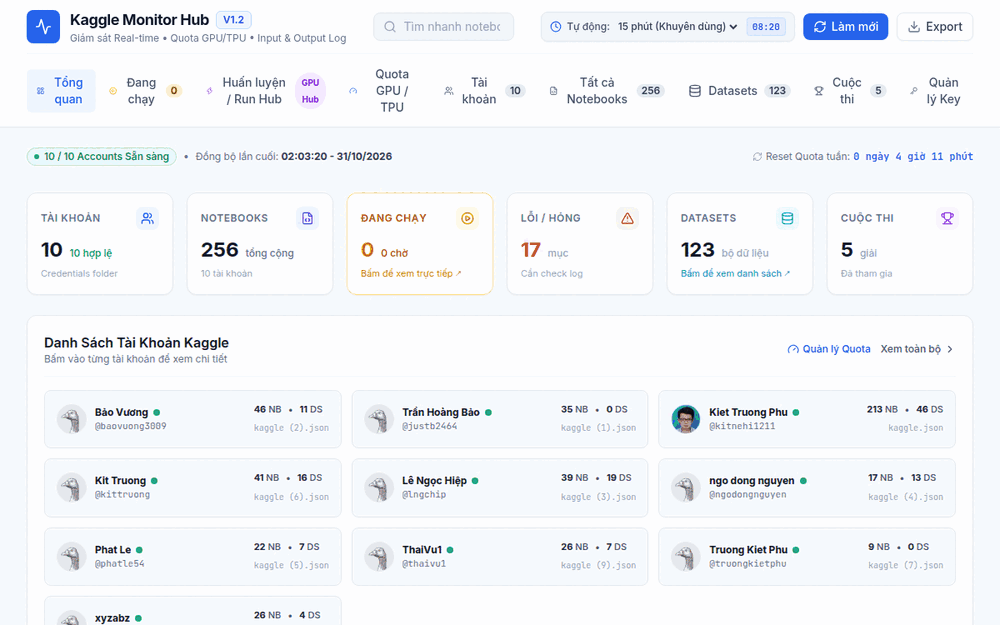
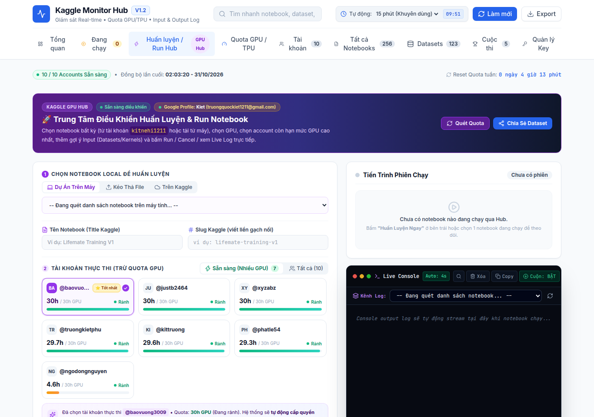
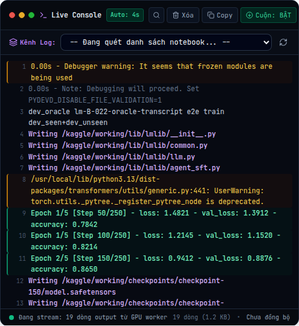
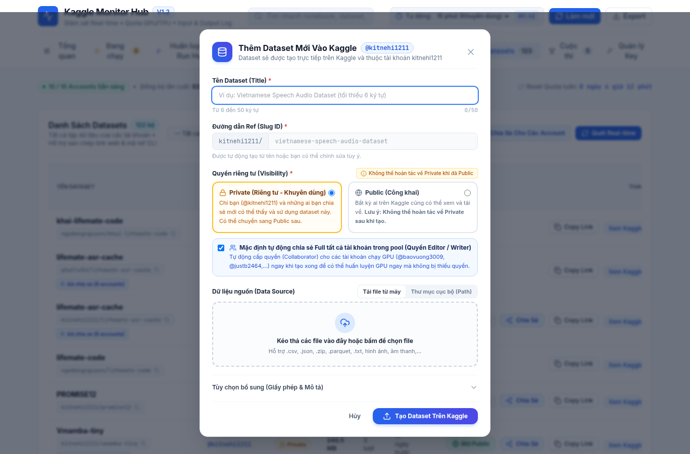
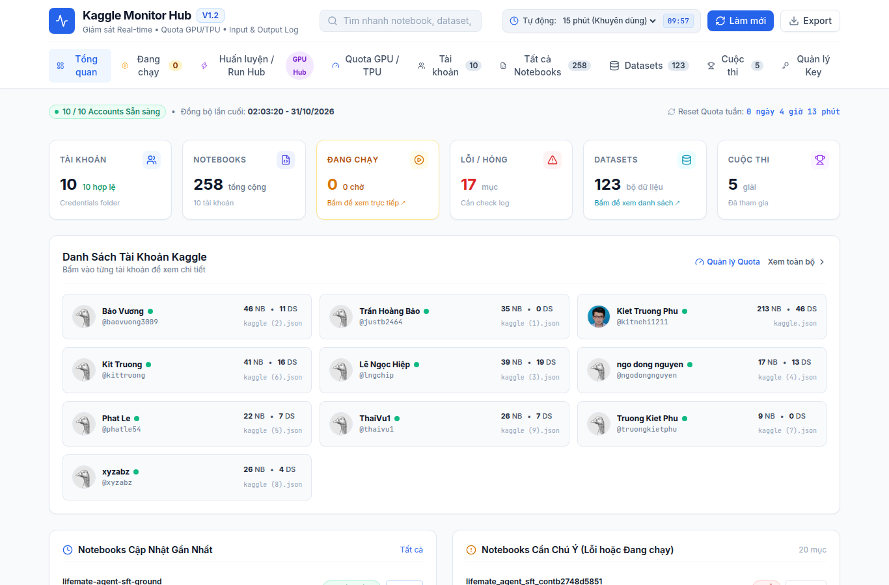
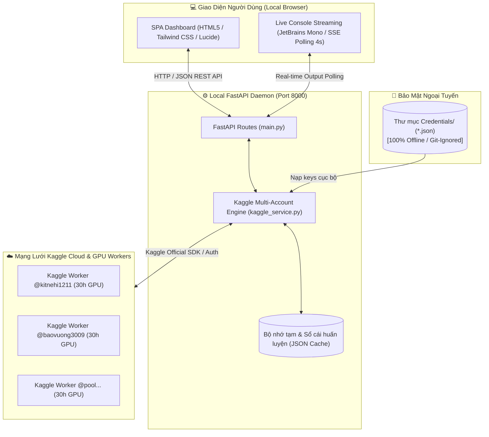

<div align="center">

# ⚡ Kaggle Multi-Account Monitor & Training Hub
### 🚀 Trung Tâm Giám Sát, Huấn Luyện Đa Tài Khoản & Quản Trị Quota Kaggle GPU Tự Động

<p align="center">
  <a href="https://github.com/Kietnehi/Dashboard-Kaggle">
    
  </a>
</p>

<p align="center">
  
  
  
  
  
  
</p>

<a href="https://github.com/Kietnehi/Dashboard-Kaggle">
  
</a>

<p align="center">
  <b>Bảng điều khiển cục bộ tất-cả-trong-một (All-In-One Local Control Center) dành cho Kỹ sư AI, Nhà nghiên cứu Deep Learning và Data Scientists làm việc trên Kaggle.</b>
  <br/>
  <i>Quản lý 10+ tài khoản song song · Tự động chọn tài khoản nhiều GPU nhất · Live Output Streaming 4s · Dataset Studio · 100% Local & Riêng tư</i>
</p>

[✨ Xem Tính Năng](#-tính-năng-đột-phá) •
[⚡ Cài Đặt Nhanh](#-cài-đặt--khởi-chạy-trong-30-giây) •
[🖥️ Giao Diện Trực Quan](#-giao-diện-thực-tế) •
[🔒 Bảo Mật 100%](#-cam-kết-bảo-mật-tuyệt-đối--100-local) •
[📖 Tài Liệu API](#-danh-sách-api-local)

<br/>

---

### 🎥 Demo Trải Nghiệm Giao Diện Thực Tế

<p align="center">
  
</p>

</div>

---

## 💡 Tại sao bạn nhất định phải dùng công cụ này?

Khi huấn luyện các mô hình AI lớn (LLM SFT / Fine-tuning, LoRA, Stable Diffusion, Whisper) hoặc thi đấu Kaggle, người dùng thường đối mặt với những rào cản lớn:

| Nỗi đau thường ngày khi dùng Web Kaggle 😫 | Giải pháp với Kaggle Monitor Hub 🚀 |
|---|---|
| **Hạn mức 30h GPU/tuần cạn kiệt giữa chừng:** Phải tạo thêm tài khoản, đăng nhập/đăng xuất liên tục, xóa cookie, rất dễ nhầm lẫn. | **Pool 10+ tài khoản gộp = 300h+ GPU Tesla T4/tuần:** Quản lý toàn bộ trên 1 màn hình duy nhất, không cần đăng xuất. |
| **Không biết tài khoản nào còn quota:** Phải bấm vào Settings của từng tài khoản kiểm tra thủ công. | **Smart GPU Recommender:** Tự động quét và gợi ý tài khoản còn nhiều GPU nhất (30h/30h) lên hàng đầu để bạn bấm chạy ngay. |
| **Phải tải lại (re-upload) Dataset 30GB - 50GB qua từng account:** Tốn hàng giờ chờ upload và băng thông mạng. | **Collaborator Automation:** 1 cú nhấp tự động cấp quyền `WRITER`/`READER` cho toàn bộ tài khoản trong pool. |
| **Console log trên Web bị trễ, khó bắt lỗi traceback:** Khi notebook crash phải tải lại trang nhiều lần mới thấy log. | **Pro IDE Live Console:** Stream log trực tiếp mỗi 4s, tự động bắt khối Traceback/CUDA OOM, tô màu cú pháp, tìm kiếm và toàn màn hình. |
| **Nguy cơ lộ API Key khi dùng các dịch vụ bên thứ ba:** | **100% Local & Offline First:** Toàn bộ file `kaggle.json` nằm trên ổ cứng máy bạn, được `.gitignore` bảo vệ tuyệt đối. |

---

## 🌟 Tính Năng Đột Phá

### 1. 🚀 Trung Tâm Huấn Luyện & Điều Khiển Run Hub (Multi-Account GPU Hub)
- **Tùy biến nguồn Notebook linh hoạt:** Chạy bất kỳ notebook nào từ tài khoản master `@kitnehi1211`, các tài khoản phụ, hoặc kéo-thả trực tiếp tệp `.ipynb` / `.py` từ máy tính.
- **Gợi ý GPU thông minh (Smart Allocator):** Thuật toán tự động xếp hạng tài khoản có hạn mức GPU dồi dào nhất (ví dụ: `30h/30h` như `baovuong3009`, `justb2464`, `xyzabz`) để tránh làm nghẽn tài khoản chính.
- **Autocomplete Input Sources:** Gợi ý tức thì từ kho 120+ Datasets và 250+ Notebooks của bạn; bổ sung Input Data chỉ bằng 1 cú nhấp chuột.
- **Kiểm soát phiên chạy toàn diện:** Nút bấm Bắt đầu (Push & Run) headless qua API, Hủy/Dừng phiên tức thì (Cancel API & Chrome profile fallback).

<p align="center">
  
</p>

---

### 2. 💻 Live Streaming Console Output Log chuẩn macOS & IDE Pro
- **Giao diện Terminal đẳng cấp:** Phong cách cửa sổ macOS với typography đơn cự **JetBrains Mono**, dải màu tối chuẩn IDE.
- **Cột đánh số dòng (Line Numbers Gutter):** Đánh số thứ tự từng dòng log rõ ràng, không dính vào clipboard khi sao chép text.
- **Nhận diện lỗi & Traceback thông minh:** Khối lỗi `Traceback (most recent call last):`, `RuntimeError`, `CUDA out of memory` được đóng khung đỏ rực rỡ; các cảnh báo `UserWarning` màu vàng amber; chỉ số `Epoch / loss / accuracy` màu xanh ngọc.
- **Tìm kiếm log thời gian thực (Live Regex Search):** Lọc nhanh từ khóa trực tiếp trên màn hình log đang stream.
- **Chế độ Toàn màn hình (True Fullscreen IDE Mode):** Mở rộng khung console toàn màn hình với nền mờ `backdrop-blur-sm`, hỗ trợ phím tắt `Esc` để đóng.
- **Nút cuộn "Xuống mới nhất" & Auto-scroll toggle:** Không lo bị giật màn hình khi bạn đang cuộn lên đọc log cũ.

<p align="center">
  
</p>

---

### 3. 📦 Kaggle Dataset Studio & Quản Lý Quyền (Private ↔ Public)
- **Tạo Dataset siêu tốc:** Tải file trực tiếp từ máy (kéo thả đa tệp `.csv`, `.json`, `.parquet`, `.safetensors`, `.zip`...) hoặc trỏ thư mục cục bộ trên ổ cứng (tối ưu cho dataset hàng chục GB).
- **Kiểm tra Slug thời gian thực:** Tự động xác thực đường dẫn Dataset khả dụng trước khi bấm tạo.
- **Quản lý quyền riêng tư an toàn:** Hỗ trợ tạo **Private (Riêng tư - Mặc định)** hoặc **Public (Công khai)**, kèm tính năng 1-click mở Public cho dataset của tài khoản.
- **Tự động phân quyền Collaborator:** Tự động chia sẻ quyền `WRITER` / `EDITOR` cho tất cả các tài khoản trong pool để mọi tài khoản phụ đều nạp được dataset vào notebook huấn luyện.

<p align="center">
  
</p>

---

### 4. 📊 Tổng Quan Giám Sát & Quản Trị Quota Thời Gian Thực
- Theo dõi toàn bộ tài khoản, tổng số Notebooks (250+), Datasets (120+), Competitions đang tham gia.
- Bảng đo Quota GPU/TPU trực tiếp với biểu đồ thanh tiến trình trực quan.
- **Đồng hồ đếm ngược Reset Quota tuần:** Tính toán chính xác thời điểm Kaggle hồi phục 30h GPU mới (vào mỗi sáng thứ Bảy UTC).
- **Tự động đồng bộ ngầm (Auto-Refresh Daemon):** Tự động làm mới dữ liệu định kỳ (10p, 15p, 30p, 1h) kèm thuật toán bảo vệ chống chạm trần Rate Limit của Kaggle.

<p align="center">
  
</p>

---

## ⚡ Cài Đặt & Khởi Chạy Trong 30 Giây

### Bước 1: Clone mã nguồn về máy
```bash
git clone https://github.com/Kietnehi/Dashboard-Kaggle.git
cd Dashboard-Kaggle
```

### Bước 2: Cài đặt thư viện phụ thuộc
Khuyến nghị sử dụng môi trường ảo Python 3.10 trở lên:

```bash
# Tạo môi trường ảo
python -m venv .venv

# Kích hoạt môi trường (Windows PowerShell):
.\.venv\Scripts\Activate.ps1
# Hoặc trên Linux / macOS:
source .venv/bin/activate

# Cài đặt thư viện
pip install -r requirements.txt
```

### Bước 3: Nạp các tài khoản Kaggle của bạn
Tạo thư mục `Credentials/` (nếu chưa có) và đặt các file `kaggle.json` tải về từ trang cá nhân Kaggle của từng tài khoản vào đây:

```text
Credentials/
├── kaggle.json        # Tài khoản master
├── kaggle (1).json    # Tài khoản phụ 1
├── kaggle (2).json    # Tài khoản phụ 2
└── ...
```

> [!TIP]
> **Cách lấy API Key từ Kaggle:** Đăng nhập vào [Kaggle](https://www.kaggle.com) ➔ Bấm vào ảnh đại diện góc trên bên phải ➔ **Settings** ➔ Cuộn xuống mục **API** ➔ Bấm **Create New Token**. Trình duyệt sẽ tự tải về file `kaggle.json`.

### Bước 4: Khởi chạy Website

#### 🪟 Trên Windows (Chỉ 1 click):
Bấm đúp chuột vào file:
```cmd
run_dashboard.bat
```

#### 🐧 Trên Linux / macOS:
```bash
chmod +x run_dashboard.sh
./run_dashboard.sh
```

Trình duyệt sẽ tự động mở trang điều khiển tại:
```text
http://localhost:8000
```

---

## 🔒 Cam Kết Bảo Mật Tuyệt Đối (100% Local)

> [!IMPORTANT]
> **Dự án tuân thủ nghiêm ngặt nguyên tắc Zero-Knowledge & Local-First:**
> - Toàn bộ API keys, token và thông tin tài khoản được lưu trữ **hoàn toàn cục bộ** trong máy tính của bạn (thư mục `Credentials/`).
> - File [.gitignore](.gitignore) đã được cấu hình chặt chẽ để **loại trừ 100%** thư mục `Credentials/`, file cấu hình `config.json`, file cache `data_cache.json` và log hệ thống.
> - Không có bất kỳ telemetry, máy chủ trung gian hay dịch vụ bên thứ ba nào thu thập thông tin của bạn. Mã nguồn hoàn toàn mở để bạn kiểm tra từng dòng code.

---

## 🏗️ Kiến Trúc Hệ Thống (System Architecture)



---

## 📖 Danh Sách API Local

FastAPI tích hợp sẵn Swagger UI tương tác trực tiếp tại: `http://127.0.0.1:8000/docs`

| Method | Endpoint | Mô tả chức năng |
|:---:|---|---|
| `GET` | `/api/overview` | Lấy số liệu thống kê tổng quan (Accounts, Notebooks, Datasets, Competitions, Quota) |
| `GET` | `/api/accounts` | Danh sách chi tiết các tài khoản Kaggle trong pool và quota hiện tại |
| `GET` | `/api/kernels` | Danh sách notebooks, hỗ trợ tìm kiếm và lọc trạng thái |
| `GET` | `/api/kernel/live-output` | Stream logs console thời gian thực từ kernel đang chạy |
| `POST` | `/api/kernel/cancel` | Gửi yêu cầu dừng/hủy phiên chạy của notebook qua API Token |
| `POST` | `/api/kernel/delete` | Xóa vĩnh viễn notebook trên Kaggle qua API |
| `GET` | `/api/datasets` | Danh sách datasets của các tài khoản |
| `POST` | `/api/datasets/create` | Tạo dataset mới qua upload tệp (Multipart form) |
| `POST` | `/api/datasets/create-local` | Tạo dataset trực tiếp từ đường dẫn thư mục trên ổ cứng |
| `POST` | `/api/datasets/set-privacy` | Cập nhật quyền Private ↔ Public cho dataset |
| `GET` | `/api/datasets/check-slug` | Kiểm tra tính khả dụng của slug dataset trước khi tạo |
| `GET` | `/api/datasets/collaborators` | Lấy danh sách cộng tác viên đang được chia sẻ dataset |
| `POST` | `/api/quotas/scan-now` | Kích hoạt quét quota GPU/TPU trực tiếp từ máy chủ Kaggle |
| `POST` | `/api/refresh` | Đồng bộ toàn diện lại toàn bộ dữ liệu từ Kaggle |
| `GET` | `/api/settings/auto-refresh` | Xem trạng thái và thời gian đếm ngược của bộ tự động đồng bộ |
| `POST` | `/api/settings/auto-refresh` | Tùy chỉnh chu kỳ tự động đồng bộ ngầm (10p, 15p, 30p, 1h hoặc Tắt) |

---

## 📁 Cấu Trúc Mã Nguồn

```text
Dashboard-Kaggle/
├── assets/                     # Ảnh chụp giao diện, banner & demo GIF
│   ├── dashboard-demo.gif      # Ảnh động demo toàn bộ dashboard
│   ├── hero-overview.png       # Ảnh tổng quan Dashboard
│   ├── training-hub.png        # Ảnh Trung tâm huấn luyện Run Hub
│   ├── live-terminal.png       # Ảnh Console Live Output IDE
│   └── dataset-studio.png      # Ảnh Kaggle Dataset Studio
├── Credentials/                # [Local only - Không commit] Nơi chứa các file kaggle.json
├── static/
│   └── index.html              # Toàn bộ giao diện Single Page App hiện đại
├── kaggle_service.py           # Core Engine: Đa tài khoản, đồng bộ quota & API
├── main.py                     # Máy chủ FastAPI Backend & API routes
├── start.py                    # Trình khởi chạy kèm tự động mở Google Chrome Profile
├── run_dashboard.bat           # File chạy 1-click cho Windows
├── run_dashboard.sh            # File chạy 1-click cho Linux / macOS
├── test_dataset_features.py    # Bộ Unit test tự động kiểm thử tính năng
├── requirements.txt            # Danh sách thư viện Python
└── README.md                   # Tài liệu hướng dẫn sử dụng
```

---

## 🤝 Đóng Góp & Hỗ Trợ

Mọi đóng góp nhằm hoàn thiện dự án đều rất được hoan nghênh:
1. **Fork** repository này về tài khoản của bạn.
2. Tạo nhánh tính năng mới (`git checkout -b feature/tinh-nang-moi`).
3. Commit thay đổi (`git commit -m 'feat: them tinh nang x'`).
4. Push lên nhánh của bạn (`git push origin feature/tinh-nang-moi`).
5. Mở một **Pull Request** để cùng thảo luận.

---

## 🔗 Author's GitHub

<div align="center">


<p align="center">
  <a href="https://github.com/Kietnehi">
    
  </a>
</p>

<h3>🚀 Truong Phu Kiet (@Kietnehi)</h3>

<a href="https://github.com/Kietnehi">
  
</a>

<br/><br/>

<p align="center">
  
  
</p>

<p align="center">
  <a href="https://github.com/Kietnehi?tab=followers">
    
  </a>
  <a href="https://github.com/Kietnehi">
    
  </a>
</p>

<h3>🛠 Tech Stack</h3>
<p align="center">
  <a href="https://skillicons.dev">
    
  </a>
</p>
<p align="center">
  <b>Core Technologies:</b> Python 3.10+, FastAPI, Kaggle Official SDK, Tailwind CSS, Lucide, Playwright, Uvicorn
</p>

<br/>

<h3>🌟 Kaggle Multi-Account Monitor & Training Hub</h3>
<p align="center">
  <a href="https://github.com/Kietnehi/Dashboard-Kaggle">
    
    
    
  </a>
</p>

<!-- Dynamic quote -->
<p align="center">
  
</p>

<p align="center">
  <i>Thank you for visiting! Don’t forget to click <b>⭐️ Star</b> to support the project.</i>
</p>


</div>
